# sharness-ai: a policy the kernel enforces, for every process an AI agent starts

[](https://pypi.org/project/sharness-ai/)
[](https://pypi.org/project/sharness-ai/)
[](https://github.com/SHarness-AI/SHarness-AI__CLI/actions/workflows/tests.yml)
[](https://sharness.ai)
[](https://sharness.ai/code/playground/index.html)

**SHarness** runs an agent's tools as small processes, each under a **Process Behaviour Policy**:
what it may read, write, run and connect to, named by one hash the person supplies and enforced
by the Linux kernel. A tricked agent cannot widen it, because the kernel was told before the
process started. Standard library only, Python 3.11+.



## Try it in 60 seconds

**In your browser, nothing installed:** [the playground](https://sharness.ai/code/playground/index.html)
puts `pip install sharness-ai` in Pyodide next to a shell on a real Linux kernel with Landlock, booted
in the tab, where every `sharness-ai run` is enforced. Or just [watch the kernel boot](https://sharness.ai/code/browser/demo/index.html).

**On Linux (5.13 or later):**

```bash
pip install git+https://github.com/SHarness-AI/SHarness-AI__CLI@dev
sharness-ai                                         # the guide: where you are, the ladder, what to do next
sharness-ai hello                                   # the acceptance test: six probes, six held
sharness-ai policy new my-tool.json                 # five questions write a policy; its hash is its name
sharness-ai run --policy my-tool.json -- my-tool    # any command, under it: the plan, then the command
```

With no arguments on a terminal, `sharness-ai` draws where you are (the kernel, Landlock, what a policy
will do here), the four steps and which you have taken, the policy in the current directory, and a menu.
Every screen ends with the next command; every refusal names who refused (the kernel, the page, or
sharness-ai itself) and the row of the policy to change. On a pipe, under `NO_COLOR`, on a serial
console or with `--plain`, the same screens are drawn in ASCII; `--json` is on every command that has
data. The design, written before the code: [The CLI is the front door](https://sharness.ai/articles/the-cli-is-the-front-door.html).



**Then tell us what it said.** `sharness-ai hello --json` and
[a two-field report](https://github.com/SHarness-AI/SHarness-AI__CLI/issues/new?template=hello-report.yml):
every machine becomes a row on [sharness.ai/evidence/machines](https://sharness.ai/evidence/machines/index.html),
and a refusal that did not happen is the most useful thing you can send.

> **Status: experiments.** No SHarness component (launcher, kms, net, fs, bash, llm) is built. This
> package carries the experiments: `probe`, `policy hash|check|translate`, `run`, `hello`, and a
> browser bench where the same guest kernel runs in Node, in a tab and through chroot. The release
> on PyPI (v0.1.0) is the skeleton; the commands are on `dev`, the default branch, and ship with the
> next release from `main`. The design is published for review at [sharness.ai](https://sharness.ai).

## What is enforced, by what, and the caveat

| In the policy | Enforced by | Measured |
|---|---|---|
| `files.read`, `files.write`, `files.exec` (path prefixes) | Landlock path rules, applied in the child before `execve` | writes refused, reads allowed, in five places |
| `network: {"connect_tcp_ports": [443]}` | Landlock TCP port rules (ABI 4+, Linux 6.7+) | port 80 `EACCES`, port 443 allowed |
| `network: "none"` | an empty network namespace where the process may make one, else Landlock denying every TCP bind and connect | the connect refused |
| `process.max_memory_mb`, `process.max_pids` | `RLIMIT_AS` and `RLIMIT_NPROC`, plus a memory and pids cgroup where `/sys/fs/cgroup` is writable | 400 MiB under 128 MiB raises `MemoryError`; the fifth fork under `max_pids: 4` fails |
| `process.no_new_privs` | `prctl(PR_SET_NO_NEW_PRIVS)` | set before every run |
| the hash | `--expect-hash sha256:…` refuses to run anything else, exit 125 | a wrong hash runs nothing |

Not here yet: seccomp, per-component uids, mutual TLS, hostnames (ports only), UDP (Landlock does not
see it, so without the namespace DNS still resolves), the launcher, any component.

**The caveat is part of every result.** A policy a process applies to its own children is a
Boundary for them and only a Setting for itself: it could have skipped it. Making it a Boundary for
the agent too needs the launcher above the agent, which is the design, not yet code:
[who enforces decides](https://sharness.ai/design/policies/index.html#2-who-enforces-decides-the-barrier-kind).

## A real Linux kernel, in a browser tab



`experiments/browser/` builds one Alpine x86 guest (Alpine's `linux-virt` kernel, Landlock on, Python
3.12, this package, the example policies) with the standard library, and runs it three ways:
`npm run node` (v86 in Node, no browser), `npm run browser` (the page in headless Chromium) and
`sudo npm run native` (the same i386 binaries through chroot on the host kernel). `hello` held 6 of 6
in all three on 25 Oct 2026. The story, with screenshots: [Linux in a tab](https://sharness.ai/articles/linux-in-a-tab.html).

## Example policies

Seven in [experiments/policies/](experiments/policies/README.md): two minimal examples and five
profiles with `/work` as the workspace, from P0 (a hello world, 64 MiB, 8 processes) through P1 (a
coding agent's session), P2 (a tool or MCP server on stdio, read-only, no network), P3 (the sgit.ai
newsroom agent) to P4 (the sgit CLI). Each hashes to the same value in Python, in the browser and
in the Linux guest. One policy, written once, can also be written for another enforcer:

```bash
sharness-ai policy translate experiments/policies/p1-agent-session.json --to claude-code   # or bwrap, docker, kubernetes
```

prints the target's form and then, line by line, what that target does **not** enforce: the
[enforceability matrix](https://sharness.ai/landscape/enforceability/index.html), made executable.

SHarness is unrelated to Sharness, the shell testing library.

## The commands: the first experiments

Numbered and described in [experiments/README.md](experiments/README.md); the map of mockups,
experiments and storyboards is [sharness.ai/code/experiments](https://sharness.ai/code/experiments/index.html).

| Command | Experiment | What it shows |
|---|---|---|
| `sharness-ai probe` | E01 | the **grant**: what a process here can do before any policy (uid, capabilities, Landlock ABI, `memfd_secret`, namespaces, tools, whether egress is proxied). Read-only; prints the names of proxy variables, never values |
| `sharness-ai policy hash FILE` | E02 | the one value the person supplies: canonical JSON → `sha256:…`. The [browser mockup](https://sharness.ai/explain/mockups/policy-hash.html) produces the same hash from the same file |
| `sharness-ai policy check FILE` | E02 | the shape of a v0 Process Behaviour Policy (paths as written are what the kernel binds: normalised, no `..`, no control characters; no duplicate keys; integers JavaScript keeps exact), then advice on what a well-formed policy still grants more of than its page suggests |
| `sharness-ai policy translate FILE --to bwrap\|docker\|claude-code\|kubernetes\|landlock [-- CMD…]` | E10 | the same policy in another enforcer's form (a bubblewrap or `docker run` command line, a Claude Code sandbox `settings.json` fragment, a Kubernetes Pod and NetworkPolicy), followed by the list of what that target does **not** enforce: the [enforceability matrix](https://sharness.ai/landscape/enforceability/index.html), row by row |
| `sharness-ai run --policy FILE [--expect-hash sha256:…] [--best-effort] -- CMD…` | E03 | one command under a policy: Landlock file and exec rules (a writable path is never executable), TCP port rules, no network, a memory cap and a process-count cap (`RLIMIT_AS`, `RLIMIT_NPROC`, and a cgroup where one can be made). Refuses to run anything if the hash does not match, if a writable path resolves elsewhere through a symlink, or if a row of the policy cannot be enforced on this kernel (`--best-effort` runs anyway and says what was not enforced). Always says what Landlock never covers |
| [the playground](https://sharness.ai/code/playground/index.html), or `experiments/browser/playground.html` | E09 | type `sharness-ai` into Pyodide (`pip install`, then hash, check, translate; `run` and `hello` refuse with no kernel) and into a shell on the Linux guest (everything, enforced); one policy hashed three ways |
| `experiments/browser/`: `npm run node`, `npm run browser`, `sudo npm run native` | E09 | the same `hello` and `run` under a second kernel: Alpine x86 with Landlock booted by v86 in Node and in a browser tab, and the same binaries through chroot on the host kernel |
| `sharness-ai hello` | E04 | the memo's acceptance test for one child process: read allowed, writes refused, network refused, a 400 MiB allocation under a 128 MiB cap refused, wrong hash refused. A refusal counts only when it came from the policy; an ambiguous one is checked against a control run without the policy and reported *inconclusive* if the environment refused it too. Exit 0 when nothing failed |
| `sharness-ai policy new [FILE]`, `policy show FILE`, `policy edit FILE` | | the wizard: five questions (read, write, exec, ports, memory), every default shown before it is accepted, the policy drawn as one process with its edges, the file written, its hash and the `run` command printed; `show` draws any policy; `edit` changes one edge and shows the name change. Flags (`--write /work/out --ports 443 -y`) answer without asking, for scripts |
| `sharness-ai components [NAME]`, `sharness-ai net` (and `bash`, `kms`, `fs`, `llm`, `launcher`) | | the operating system a process sees, drawn, with honest status: all seven designed, none built. A component's verb prints its proposed REST surface and exits 69 (unavailable) until it is runnable |
| `sharness-ai guide [--once]` | | the no-arguments screen, for a pipe or a script |
| `sharness-ai contain --workspace . --sites github.com -- CMD` | level 5 | one sentence (a workspace, sites, secrets, a profile) compiled deterministically down to the v0 policy the kernel holds and run under it; prints what it became at each level, one hash, what is held, what is not held yet (host names, until `sharness.net`), what is never covered. `--save FILE` keeps the sentence; `--expect-hash` refuses any other |
| `sharness-ai profile list\|show NAME` | level 4 | the roles a vendor ships with blanks a person fills: the example policies P0 to P5 as templates (`coding-agent`, `tool-server`, `hello-world`, …) |
| `sharness-ai explain FILE` | all | any document (level 5, 4, 3 or a v0 policy) drawn down the levels to the kernel, one box per level, a hash beside each, the unheld and passed-through rows named. `policy show\|check` read a levelled document too |
| `sharness-ai session new --roles app fs` | E05 | a session CA and one identity per role, issued by `openssl` (P-256, TLS 1.3, SAN URI `spiffe://<session>/<role>`), the CA key destroyed; what every door and every caller loads. No Python dependency |
| `sharness-ai fs serve --target disk\|disk.twin --root DIR`, `fs hello\|put\|append\|get\|rm\|ls\|log` | the first door | `sharness.fs`, the only writer, as a loopback service under mutual TLS: the caller's role read from its certificate, the edge checked both ways, every request matched against `ACCEPTS.json`, then the rows (`within_root` and `refuse_secrets` always; `max_bytes`, `append_only` per path), one audit line per request. `disk` is the local disk; `disk.twin` the same face over memory |
| `sharness-ai door conformance sharness.fs.disk.twin\|sharness.fs.disk` | | the door's 18 vectors against a fresh instance, the twin first, then the disk; exit 0 only when every vector held |
| `sharness-ai net serve --hosts github.com pypi.org`, `net hello\|log` | the second door | `sharness.net.proxy`: an HTTP proxy on loopback for one uid under a host allowlist (exact or `*.suffix`), ports 443 and 80, IP literals refused, a tunnel whose TLS hello names another host cut, one audit line per request. Point any program's `HTTPS_PROXY` at it and watch the verdicts |
| `sharness-ai shell --workspace . --sites github.com [-- CMD]` | the launcher's first slice | an interactive shell under the harness: a unique system uid where the launcher is root, the net door started for that uid, the shell's policy compiled from the sentence with the proxy's port as its **only** network row (the kernel holds the port, `sharness.net` holds the hosts, so the host allowlist is a Boundary for the shell), `HTTPS_PROXY` set, a live page on loopback showing traffic, processes and every refusal as they happen, the user removed on exit |
| `sharness-ai doctor` | | can a policy hold here? Seven checks in order (kernel, Landlock files, Landlock TCP, network namespace, cgroups, process count, a real write refused under a deny-write policy), each pass, warn, fail or skip with what to do about it; a fatal failure skips the rest; `--json` is the report. Exit 0 healthy or degraded, 1 failed |
| `sharness-ai help [--format json]` | | every command, read from the parser itself, so no page can describe a flag that does not exist; the JSON is what the site's CLI page is written from |

```
$ sharness-ai hello
sharness-ai hello   experiment E04: the memo's acceptance test, for one child process
  policy          hello   generated for this interpreter and this directory
  ┌─ files ────────────────────────┐  ┌─ network ────────────┐  ┌─ process ────────┐
  │ read  /bin /etc /lib /lib64 +5 │  │ connect_tcp  none    │  │ memory  128 MiB  │
  │ write none                     │  │ UDP and Unix sockets │  │ pids    no cap   │
  │ exec  /bin /etc /lib /lib64 +4 │  │ are not covered      │  │ no_new_privs yes │
  └────────────────────────────────┘  └──────────────────────┘  └──────────────────┘
  sha256:1a2917ebce3f2de38d5d63e7a6eb99173754efdf289b21c5aed2e03bdac6b324  its name: change a row and it changes
  kernel          Landlock ABI 7 · empty network namespace: yes (uid 0)

  ✔ read      /usr (listing)               allowed
  ✔ write-tmp /tmp/…tmp (create)           refused by the kernel
  ✔ write-cwd ./…tmp (create)              refused by the kernel
  ✔ net       1.1.1.1:443 (connect)        refused by the kernel
  ✔ memory    400 MiB under 128            refused by the kernel
  ✔ hash      sha256:0000… (--expect-hash) refused by sharness-ai

  result          ████████████ 6/6 held · measured 26 Oct 2026, Landlock ABI 7
  not covered     Unix-domain sockets by path (no Landlock rule exists); the environment variables this
                  process has (inherited by the child); UDP, unless the empty network namespace applied
  report          sharness-ai hello --json, then paste it at https://github.com/SHarness-AI/SHarness-AI__CLI/issues/new?template=hello-report.yml
  caveat          applied by a process to its own child: a Boundary for the child, a Setting for the parent ...
  next            sharness-ai policy new my-tool.json   write a policy for your own tool, from five questions
```

The code follows the sgit CLI's shape: `sharness_ai/cli/CLI__Main.py` holds one class per command group
(`CLI__Probe`, `CLI__Policy`, `CLI__Run`, `CLI__Hello`, `CLI__Components`, `CLI__Guide`), each with `cmd_*`
methods bound by `set_defaults(func=…)`; one place turns an exception into a sentence with a hint;
`--debug` prints the steps with timings. `sharness_ai/ui/` draws: `Term` (where the output goes),
`Draw` (boxes, rows, the policy as one process), `Prompt` (questions that never block a script),
`Trace`. The engine modules (`probe`, `policy`, `run`, `landlock`, `limits`, `translate`, `hello`)
return objects and did not move. Every file is under 300 lines; standard library only.

**What is enforced, and by what.** Files and exec by [Landlock](https://docs.kernel.org/userspace-api/landlock.html)
path rules (Linux 5.13+, through `ctypes`, no C extension); TCP by Landlock port rules (ABI 4+,
Linux 6.7+); `network: "none"` also tries an empty network namespace. Landlock does not see UDP,
so without the namespace DNS still resolves. `process.max_memory_mb` and `max_pids` set `RLIMIT_AS`
and `RLIMIT_NPROC` on the child and, where `/sys/fs/cgroup` is writable, a memory and pids cgroup
(measured 25 Oct 2026: a 400 MiB allocation under 128 MiB raises MemoryError; the fifth fork under
`max_pids: 4` fails). `RLIMIT_NPROC` does not bind uid 0, so for root only the pids cgroup counts;
where none can be made, `max_pids` is refused rather than skipped. A writable path gets every right
but execute, so a file the child drops cannot run. A writable path that is a symlink to somewhere else
is refused before anything runs: the policy's page must be what the kernel binds. Every descriptor
above 2 is closed in the child, because Landlock binds new opens, not inherited ones. **Not covered,
and said on stderr every run:** Unix-domain sockets by path (Landlock has no rule for them), the
environment the child inherits (v0 has no row for it), UDP when no network namespace could be made.
Not here yet: seccomp, per-component uids, mutual TLS, the launcher, any component. Standard library only; Python 3.11+.

**The caveat is part of the result.** A policy a process applies to its own children is a Boundary
for them and only a Setting for itself (it could have skipped it). Making it a Boundary for the
agent too needs the launcher above the agent: [who enforces decides](https://sharness.ai/design/policies/index.html#2-who-enforces-decides-the-barrier-kind).

**For a Claude Code session:** the skill in [.claude/skills/sharness-hello](.claude/skills/sharness-hello/SKILL.md)
runs E01 and E04 inside the session under the design's safety rules and reports the result in the
site's status words.

## The first door, and the two halves together

`sharness.fs` runs: `sharness-ai session new`, then `sharness-ai fs serve --target disk --root ./work`, then
an app under a policy whose `files.write` does not include `./work` and whose ports include the door's.
Measured 26 Oct 2026 on this kernel (Linux 6.18, Landlock ABI 7): the app's own `open(…, 'w')` in the root
is refused by the kernel (`EACCES`); its `PUT` through the door is written (`201`); its `PUT` of a private
key is refused by the door (`403 refuse_secrets`); a path that climbs out is refused (`403 within_root`); a
write to an `append_only` path is refused and an append lands. That is the design's two halves in one
test (`tests/unit/fs/test_fs.py`): the kernel closes the side door, the door holds the rows. It is a
**Setting** for the app until the launcher (not built) gives the door its own uid; `GET /v0/hello` says so.

The code shape is the brief's: every door, target, twin and level is a folder with `README.md`,
`REALITY.md`, `ACCEPTS.json`, `EMITS.json` and `vectors/` (`sharness_ai/door/`, `sharness_ai/fs/`,
`sharness_ai/fs/disk/`, `sharness_ai/fs/disk/twin/`, `sharness_ai/level/l{3,4,5}/`), replaceable by an
implementation in another language that speaks the same accepts and emits. Standard library only;
`openssl` is a program on the machine, not a package.

## A shell under the harness

```
$ sharness-ai shell --workspace ./work --sites sharness.ai
  who             uid 996 (sharness-d6e2fe, made for this shell, removed on exit)
  network         only 127.0.0.1:32883, sharness.net.proxy · hosts sharness.ai · HTTPS_PROXY set
  held            ✔ files, the port and the caps by the kernel · ✔ the host names by sharness.net (a Boundary for the shell)
  live page       http://127.0.0.1:41753/<token>/
── sh starts ──
$ curl -sI https://sharness.ai | head -1        → HTTP/2 200         (through the proxy, allowed)
$ curl -sI https://example.com                  → 403 from sharness.net.proxy: not on the allowlist
$ curl --noproxy '*' https://sharness.ai        → refused by the kernel: the only port is the proxy's
$ touch /etc/x                                  → Permission denied (Landlock)
── sh exit 0 ──
  summary         2 requests through sharness.net: 1 allowed, 1 refused; hosts reached: sharness.ai
```

Measured 26 Oct 2026 on this kernel (Linux 6.18, Landlock ABI 7, root): exactly that, and the live page in
headless Chromium showed the three requests with their verdicts, the shell's three processes and the two
refusals with who made them. Not on the page yet: the kernel's own refusals (Landlock audit is the next step);
the shell sees them as `EACCES`. DNS: a program that resolves names itself speaks UDP the kernel does not see;
clients that honour `HTTPS_PROXY` resolve nothing.

## Security

This is a security product, so the project keeps its own register of what it knows about itself:
the threat model, every known risk and whether it is fixed or accepted, every review's findings
with dates, and the hardening guidance are on [sharness.ai/security](https://sharness.ai/security/index.html).
[SECURITY.md](SECURITY.md) says how to report a vulnerability (GitHub private reporting). Each fix
is pinned by a test in `tests/unit/test_security.py`; `.github/workflows/security.yml` runs ruff's
bandit rules, bandit, zizmor, pip-audit, npm audit and an SBOM on every push; `codeql.yml` runs CodeQL.
Every download the browser bench makes is pinned by sha256 and refused on mismatch. The release
pipeline runs only GitHub's and pypa's actions, pinned to commits, with build and publish in separate jobs.

## Releases

Every push to `main` runs `.github/workflows/workflow.yml`: unit tests, then a version bump
(`v0.N.0` → `v0.N+1.0`, written to `pyproject.toml`, `sharness_ai/version` and the badge above),
a git tag, a build with a pinned `build`, and a publish to PyPI via Trusted Publishing (OIDC — no
API token is stored) with PEP 740 attestations. A manual run with `dry_run` builds and stops.
Day-to-day work lands on `dev` (the default branch); merging `dev` into `main` cuts a release.
